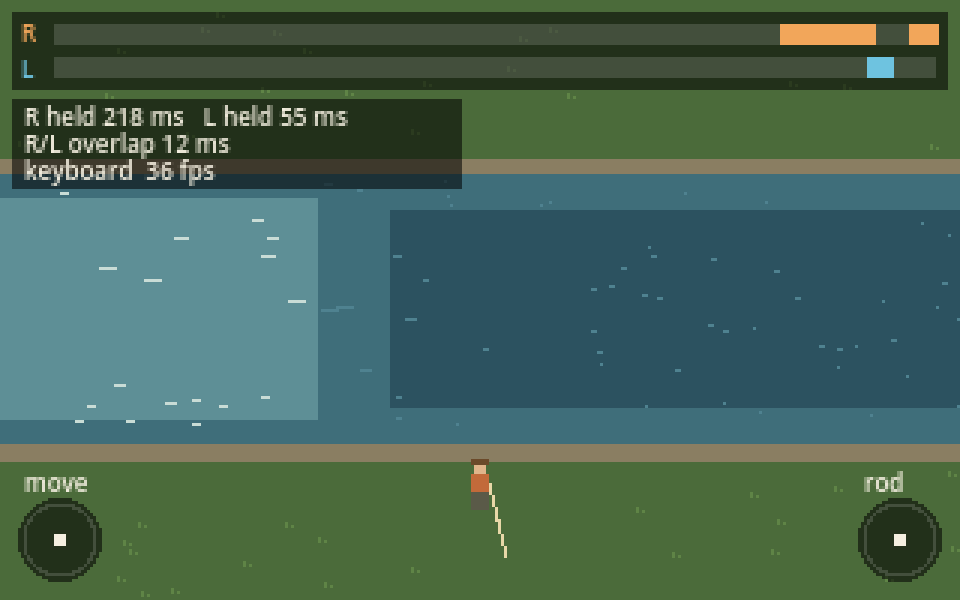

# Lodge

A cabin-core fly fishing game. A laid-off father inherits his late dad's cabin, rod and fly box in the Oregon Cascades, learns the river, and grows a guiding lodge. The game is built for Steam Deck first, with a Game Boy-inspired look and tactile bumper-and-stick casting.



## Current milestone: dry fly minigame

1. **Tooling and project skeleton** (this step). Godot project, Deck control map, placeholder stream, controller debug overlay.
2. **Casting.** Hold R for the back cast, overlap into L for the forward cast, and alternate R/L to shoot line for distance.
3. **Drift, rise, set and fight.** The fly drifts on the current, the right stick mends, a fish rises, you flick to set, then hold and play line tension. Starts with 3 flies and 3 trout.
4. **Tune on the Deck.** Timing windows, rumble, and how readable the bite cue is.

## Quick start

1. Install [Godot 4.3 or newer](https://godotengine.org/download) (the standard build, not .NET).
2. In Godot, choose **Import**, then pick this folder's `project.godot`.
3. Press **F5** to run. Plug in a controller or use the keyboard fallbacks below.

## Controls

| Steam Deck / Xbox pad | Keyboard | Action |
|---|---|---|
| R bumper | E | Back cast (hold to time it) |
| L bumper | Q | Forward cast (overlap with R) |
| Right stick | I J K L | Rod tip: mend, set the hook, strip |
| Left stick / D-pad | W A S D | Walk the bank |
| A | Space | Interact / perception check |
| B | Backspace | Back / reel in |
| Menu (Start) | Esc | Pause |
| View (Select) | F1 | Toggle controller debug overlay |

With the debug overlay open, press A to test rumble. The top strip shows the last 2 seconds of R and L presses, plus hold times and overlap in milliseconds, so the cast rhythm can be tuned with real numbers.

## Project layout

```
scenes/main.tscn            Test stream scene (entry point)
scripts/controls.gd         `Controls` autoload: action names and stick helpers
scripts/stream_scene.gd     Placeholder river, current model (flow_at), angler and rod
scripts/debug_overlay.gd    Bumper timeline, stick readouts, rumble test
tools/setup_input_map.gd    Source of truth for the input map (regenerates project.godot)
tools/capture_screenshot.gd Renders a screenshot with scripted bumper presses
tests/smoke_test.gd         Headless check, also run in GitHub Actions
export_presets.cfg          Linux x86_64 export for Steam Deck
docs/TOOLING.md             Tools, Steam Deck testing, conventions
```

See [docs/TOOLING.md](docs/TOOLING.md) for the full setup, including how to get builds onto a Steam Deck.
