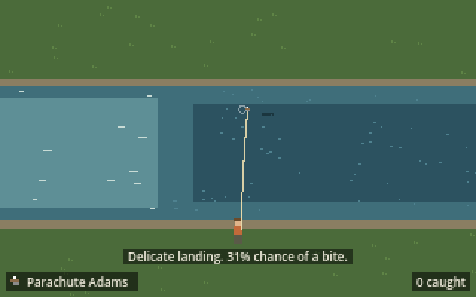
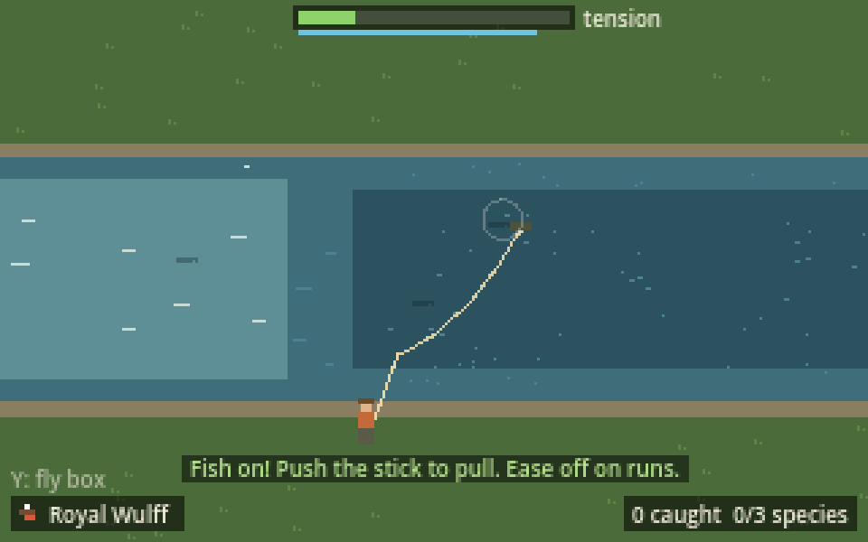
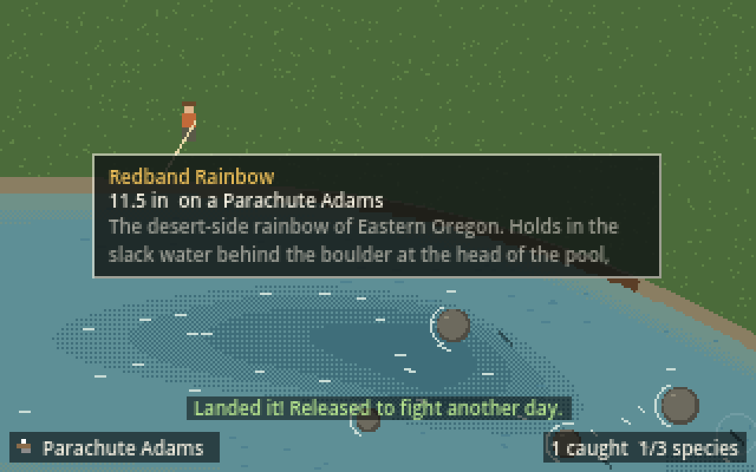
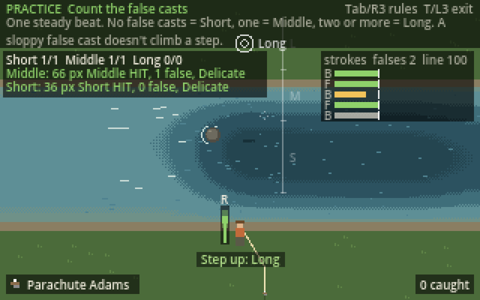
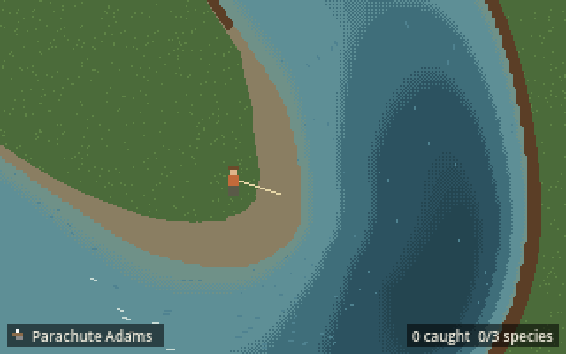
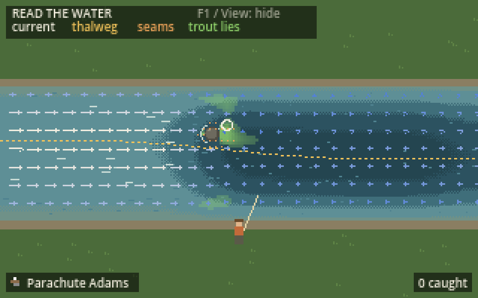

# Lodge

A cabin-core fly fishing game. A laid-off father inherits his late dad's cabin, rod and fly box in the Oregon Cascades, learns the river, and grows a guiding lodge. The game is built for Steam Deck first, with a Game Boy-inspired look and tactile bumper-and-stick casting.

| Fly on the water, 46% bite chance | Fish on | Landed |
|---|---|---|
|  |  |  |

## Current milestone: dry fly minigame

1. **Tooling and project skeleton** (done). Godot project, Deck control map, placeholder stream, controller debug overlay.
2. **Casting** (done). Hold R for the back cast, overlap into L for the forward cast, and alternate R/L to shoot line for distance.
3. **Rise, set and fight** (this step). One trout, one fly, a simple bite chance per cast, flick to set, then play line tension.
4. **Tune on the Deck.** Timing windows, rumble, and how readable the bite cue is.

## Play in the browser

The latest `main` is published at **https://travernorm.github.io/Lodge/** after every merge (`.github/workflows/web.yml`). Click the game once so it gets the keyboard, then use the keyboard controls below. A controller works too in Chrome or Edge: press a button after the page loads so the browser connects it. Rumble isn't available in the browser.

## Quick start

1. Install [Godot 4.3 or newer](https://godotengine.org/download) (the standard build, not .NET).
2. In Godot, choose **Import**, then pick this folder's `project.godot`.
3. Press **F5** to run. Plug in a controller or use the keyboard fallbacks below.

## How to cast

1. **Hold R.** The back cast unrolls behind you and the meter by the angler fills. A light rumble "tug" marks the moment the line straightens, and the fill turns green.
2. **Press L while still holding R, then let go of R.** That slight overlap (about 20 to 200 ms) shoots the forward cast. Letting go of R before pressing L collapses the cast. Holding both too long throws a tailing loop, or a wind knot if you really hang on.
3. **Hold L.** The line unrolls forward over the water. Then either:
   - **overlap back into R** for a false cast. Each clean false cast shoots more line (the dotted cross shows where it would land), or
   - **let go of L** to deliver the fly.
4. While casting, the **left stick swings your aim** upstream or downstream.
5. The fly lands **Delicate**, **Fair** or **Splashy** depending on your timing, then drifts on the current. **R** picks it up for another cast, and **B** reels in.

The longer the line, the longer each stroke needs, just like a real cast. Strokes that are too early fall short and splash down. Strokes that are too late drop the line onto the grass or the water.

## Casting practice and rule sets



Press **T** (or click the **left stick, L3**) for practice mode. Fish stop biting, and a target ring asks for a **Short**, **Middle** or **Long** cast in turn. The faint ruler by the rod marks where each distance band starts. Each landing is scored as a hit or a miss, the fly reels itself in, and the next target comes up. Press **T / L3** again to go back to fishing.

The **stroke log** (top right) shows every back (B) and forward (F) stroke of the cast as a bar. The bar's length is how long you held the bumper, the white tick is what the rules wanted, and the colour is the score (green perfect, yellow okay, red poor). The stroke you're holding right now grows in grey, so you can see your rhythm against the target as you cast.

Press **Tab** (or click the **right stick, R3**) to switch between casting rule sets. They all use the same bumpers and overlap, but turn your rhythm into distance differently:

| Rule set | Rhythm | How you get distance |
|---|---|---|
| **Count the false casts** (default) | A steady beat: 0.42 s at Short, stretching by 0.05 s with each step up | 0 false casts is Short, 1 is Middle, 2 or more is Long. A sloppy false cast doesn't climb a step |
| **Classic** | Strokes get longer as line goes out | Each clean false cast shoots 0.5 to 2 m of line. About 0 false casts is Short, 2 is Middle, 4 is Long |
| **Find your tempo** | Your first back cast sets the beat, fast or slow | Each false cast adds line in proportion to how well it kept your beat |

Distances are measured in metres from the rod tip (one screen is 40 m across): **Short** is up to 6 m, **Middle** up to 10.25 m, and **Long** beyond that, up to about 14.75 m of line. A bad delivery stroke still falls short of the line you have out, in every rule set. The numbers for each rule set live in `data/cast_rules/`, so they can be tuned in the Godot inspector. Fishing uses whichever rule set is selected, so you can also fish with each one. The game starts with Count the false casts (the `rules` property on the **Cast** node).

## How to fish

For now the stream holds **one Redband Rainbow**, holding in a good lie at the head of the pool (usually the slack pocket behind the boulder), and Dad's fly box holds **three flies**: a Parachute Adams (mayflies), an Elk Hair Caddis and a Royal Wulff (an attractor). Press **Y** (or **F**) while reeled in to tie on the next one. Watch for the rings where it rises on its own to find it.

1. **Drift the fly past the fish.** A trout judges the fly as it drifts within about 1 m of it, once per pass. The odds show at the top of the screen, for example `(Lane 20 + Delicate 20 + No drag 20) × PMD 1 = 60%`:
   - **Lane (20%):** the fly came through the fish's window at all.
   - **Landing (20%):** a delicate landing within 3 m of the fish (a fair one gets 10%). A splashy landing isn't punished, and casting right onto a fish is fine: it counts as a pass straight away.
   - **No drag (20%):** the fly rode the current through the pass. Drag, skating or an early mend's jolt anywhere in the pass loses some or all of it, so **mend before the fly reaches the fish**.
   - **× Fly match:** how much the fly looks like what that trout is eating. The right bug is ×1. A bug it doesn't eat keeps (1 − selectivity) of the odds, so a choosy cutthroat on the wrong fly keeps ×0.4, while a brook trout barely cares. Each fish's diet and selectivity are in `data/fish/`, what each fly imitates is in `data/flies/`, and the bugs are in `data/insects/`.
2. **Wait for the rise.** If the fish bites, it comes up for the fly a moment later and the fly disappears.
3. **Set the hook.** Press **Space** (or **Cross / A** on a controller, or flick the right stick up). You have about a second.
4. **Fight.** **Hold Space** or **push the right stick** to pull it in, and watch the tension bar. Don't let the line go slack for long or it throws the hook. Pushing sideways against a run tires it faster. Reel it in close once it's tired to land it.

Mend the line by looping the right stick when it bows downstream. Mend too early, with no bow to fix, and the fly skates.

**Bite rules.** Press **R** (or **Square / X** on a controller) while reeled in to switch between bite rules, a feel experiment like the casting rule sets. **Match the fly** (above) is the default. **Drift past** is the same without the fly match. **Landing roll** is the original: one roll the moment the fly lands, 60% for a delicate landing right by the fish, falling off to nothing 5 m out, with fair landings getting 60% of that and splashy ones 25%; the drift after that doesn't matter. The numbers live in `data/take_rules/`.


## Controls

| Steam Deck / Xbox pad | Keyboard | Action |
|---|---|---|
| R bumper | E | Back cast (hold to time it) |
| L bumper | Q | Forward cast (overlap with R) |
| Right stick | I J K L | Rod tip: mend, set the hook, strip |
| Left stick / D-pad | W A S D | Walk the bank (the camera follows) |
| Right stick loop | — | Mend the line |
| A or right stick flick up | Space | Set the hook |
| Right stick hold | Space or I J K L | Pressure while fighting |
| Y | F | Change fly (when reeled in) |
| A | Space | Set the hook (later: interact / perception check) |
| B | Backspace | Back / reel in |
| Menu (Start) | Esc | Pause |
| View (Select) | F1 | Cycle debug views: controller, read the water, hidden |
| Left stick click (L3) | T | Casting practice on/off |
| Right stick click (R3) | Tab | Switch casting rule set |
| X (Square on DualSense) | R | Switch bite rules (when reeled in) |

The debug views start hidden. The first press opens the controller view and gives a short rumble to test the controller's haptics. Its top strip shows the last 2 seconds of R and L presses, plus hold times and overlap in milliseconds, so the cast rhythm can be tuned with real numbers.

## The river

The demo is a stretch of freestone river, 16 m bank to bank, that winds across three screens by three ([REQ-0002](docs/requirements/REQ-0002-demo-stretch.md)). Walk the bank from the head riffle, past a boulder garden of pocket water, to a pool with an eddy and a fallen log, over a crossover riffle, and out onto the gravel point bar of a hard bend whose outside is a deep, undercut cut bank. The camera scrolls with you, and you always face the water: casting straight across goes wherever the river is from where you stand. Five trout hold in the best lies along the way. The layout is data, `data/stretches/demo_freestone.tres` (a `Stretch`: the centreline, width, depth along the river, rocks, logs and eddies).





The stream's current comes from a river field (`scripts/river/river_field.gd`) that follows real hydraulic rules: the same water passes every cross-section, so the shallow riffle runs fast and the deep pool runs slow; the fastest water follows the thalweg (the deepest line) and the banks are slow; and the boulder at the head of the pool makes a slow cushion in front, a slack pocket behind and a seam off each side. The field also scores where a trout would hold: slow, deep-enough water with fast water close by. Each trout picks its lie from those scores, at least 3 m from the others, so they sit where real ones would. In a bend the thalweg swings to the outside, so the cut bank runs deep and fast and the inside shallows into a point bar. The eddy is a real circulation (a stream-function vortex): water runs back upstream along the bank, swings out along the eddy line and curls back in, so a fly dropped in it comes back round, and trout in it face downstream into its current. The drift, the foam streaks and the water colour all read the same field.

Press **View / F1** twice for the read-the-water view. It draws the current, the thalweg, seams, trout lies and a ring where the trout is holding, and shows the speed of the lane your fly is drifting in, in metres per second. For now the field is built from those rules when the scene loads (about a second for the demo stretch); later it will be baked from a water solver in the editor, using the same layers.

The river works in metres (see REQ-0001): one screen is 40 m by 25 m. The original one-screen test creek (about 11 m wide) is still there when the stream scene has no stretch; the river tests use it. All of its speeds hang off one number, `RiverField.WATER_SPEED` (the riffle's fastest line, 6.9 m/s today, several times a real creek's 1 to 1.5 m/s). The speeds where trout hold and feed, and what counts as a seam, are fractions of it, so slowing the water toward real speeds changes one number.

## Project layout

```
scenes/main.tscn            Test stream scene (entry point)
scripts/controls.gd         `Controls` autoload: action names and stick helpers
scripts/stream_scene.gd     Placeholder river (bed, boulder, flow_at), angler and rod
scripts/river/river_field.gd  River field: current, depth, seams and trout lies on a grid
scripts/casting/            Cast rhythm logic (cast_model.gd), scene glue and drawing
                            (cast_controller.gd), tunables (cast_tuning.gd)
                            Swappable rule sets (cast_rules.gd, rules/), practice mode
                            (cast_practice.gd)
data/cast_tuning.tres       Casting feel numbers; edit in the Godot inspector
data/cast_rules/*.tres      Casting rule sets and their numbers (Classic, Count the
                            false casts, Find your tempo)
scripts/fishing/            Drift and mending (drift_model.gd), fish behaviour (fish.gd),
                            fight (fight_model.gd), stick gestures, and the scene glue
                            (fishing_controller.gd)
data/flies/*.tres           Fly patterns (FlyPattern)
data/fish/*.tres            Trout species: habitat, bite odds, hook-set window, fight
scripts/debug_overlay.gd    Bumper timeline, stick readouts, rumble test
tools/setup_input_map.gd    Source of truth for the input map (regenerates project.godot)
tools/capture_screenshot.gd Plays a scripted catch and saves screenshots
tests/smoke_test.gd         Headless check: a scripted cast, drift, hook set and fight end in a catch
tests/cast_test.gd          Headless tests for the cast rhythm
tests/cast_rules_test.gd    Headless tests for each casting rule set (Short/Middle/Long)
tests/fishing_test.gd       Headless tests for gestures, drift, rises, hook sets and fights
tests/river_test.gd         Headless tests for the river's hydraulics (thalweg, conservation, boulder)
tests/data_test.gd          Contract checks across data files, scene wiring and the input map
tests/playthrough_test.gd   Integration playthrough across casting, fishing, practice and debug views
tools/run_tests.sh          Runs every test the way CI does
export_presets.cfg          Linux x86_64 export for Steam Deck
docs/TOOLING.md             Tools, Steam Deck testing, conventions
docs/DEVELOPMENT_PROCESS.md How changes are planned, tested across systems and handed off
```

See [docs/TOOLING.md](docs/TOOLING.md) for the full setup, including how to get builds onto a Steam Deck.
