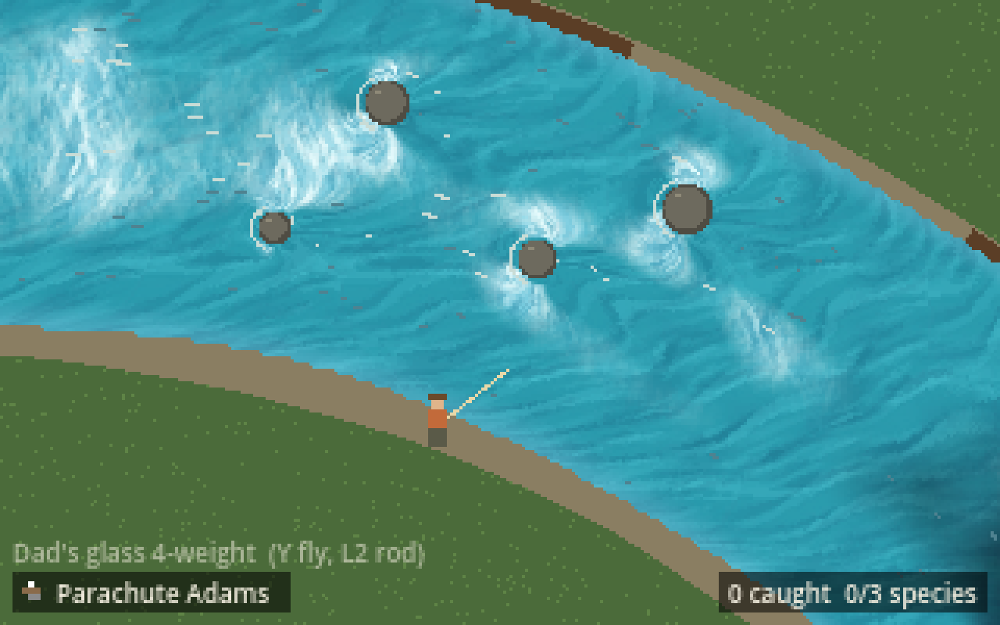
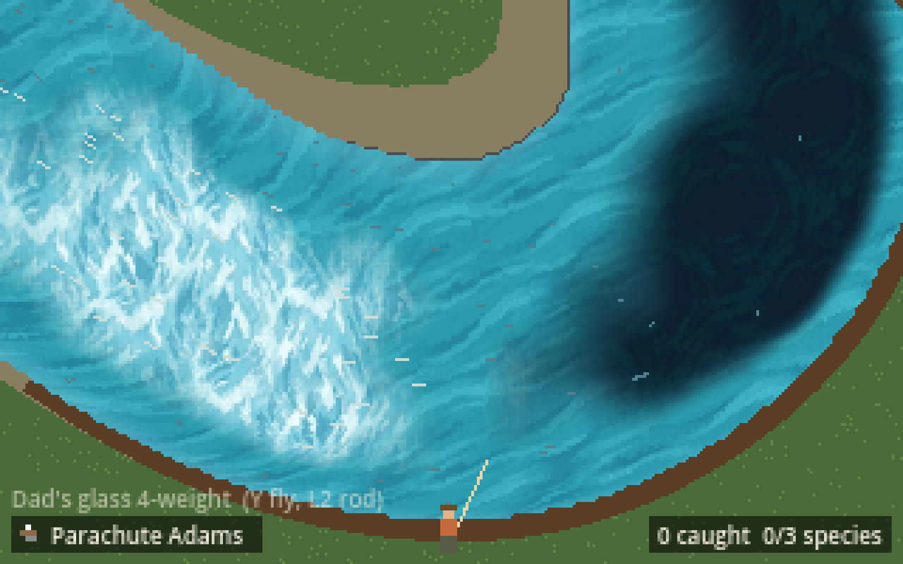

# REQ-0006: A water look you tune in Godot

Status: implemented (approved by Traver in the "Plan updated game visuals" thread, 2026-11-03)

## Problem

The water is five flat colours chosen in code. Traver is making water textures in PixelLab and needs a way to put them on the river and tune the look by eye, without code, while the water stays true to the river field the fish live in.

## Player story

As a player, I want the river to look like real water, with dark slots, white riffles and a moving surface, so that I can read where the fish are by looking.

## Scope

- `WaterLook` resource (`data/looks/water_spring.tres`): three texture slots (deep, mid, white), tints, where each texture shows (depth and speed thresholds with softness), shallow-edge tint, edge noise, dither on or off, and motion with the current.
- `WaterView` node (`Water` in `scenes/main.tscn`), plus `shaders/water.gdshader`. It bakes the `RiverField` once into a small texture (one texel per 0.25 m cell: current, depth, wet). The shader picks a texture per pixel from it and scrolls each texture along the local current (two-phase flow map). It draws behind the stream scene, which leaves its water pixels clear when a look is set.
- It runs in the editor (`@tool`), so the water shows in the viewport and changes live while the look is edited.
- Starting tiles: 64x64 seamless cuts from Traver's sheet in `assets/water/`, to be replaced by Traver's own seamless tiles.

## Out of scope

Shore and bank tiles, rocks and logs art, other seasons' looks, the resolution change.

## Systems touched

| System | Changes? | Depends on the change? | How it's checked |
|---|---|---|---|
| Casting | No | Draws over the water | playthrough_test |
| River | New view, look data and shader; the field is only read | Fishing reads the field, unchanged | water_view_test, river_test, data_test |
| Fishing | No | No | playthrough_test |
| UI and modes | No | Debug views still draw on top | playthrough_test cycles them |
| Input | No | No | input drift check |
| Saves | No | No | n/a |

## Acceptance criteria

- The field texture matches the river's current, depth and wet cells (water_view_test).
- With a look set, the stream scene leaves water clear and still paints the bank (water_view_test).
- Every look has three square textures, and the scene's look is a `data/looks` file (data_test).
- Every existing suite still passes (tools/run_tests.sh).

## Playtest checks

- Walk the demo stretch on DualSense and keyboard: the riffle, the boulder pockets, the bend pool and the tail-out should each read clearly.
- Cast Short, Middle and Long, and check that the fly, line and rise rings stay readable on the new water.
- Open `data/looks/water_spring.tres` in the editor and drag the sliders.
- Not yet checked: the Steam Deck and the browser build.

