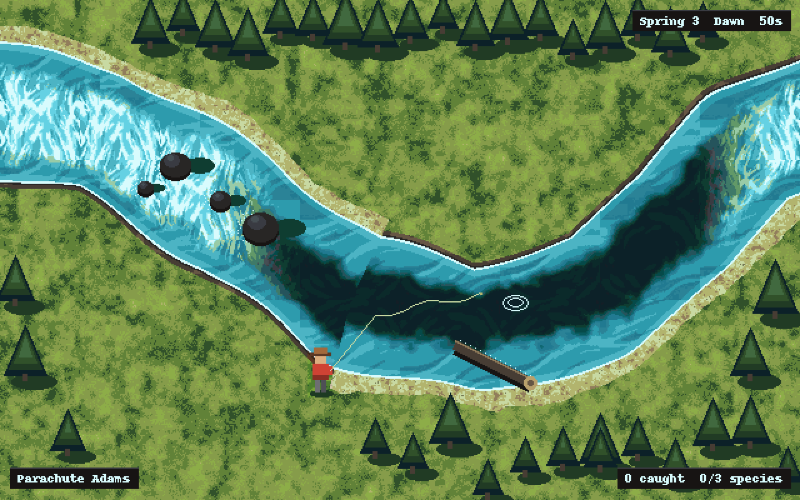

# REQ-0006: Water textures

Status: review

## Problem

The river is drawn as five flat colours with a 2x2 dither. Traver has a set of painted water textures (deep, mid, white water, transitions, a boulder with foam) and wants them in the game. Painting the river as one picture won't work, because the fishing reads the river from `RiverField` (depth, current, seams, lies). If the picture and the field disagree, the water lies to the player.

## Player story

As a player, I want the river to look like real moving water, so that I can read where the deep slots, riffles and pockets are just by looking, the same way the fish "see" them.

## Feel goals

- Depth and speed read at a glance: dark swirling slots are deep and slow, white water is fast and shallow, mid water is everything between.
- The surface moves with the current, so the riffle hurries and the pool barely creeps.
- Still pixel art at 640x400 (REQ-0007): no blur, no sub-pixel smearing, no visible tile grid.

## Scope

1. **Assets.** `assets/water/` holds three seamless fill textures (`deep`, `mid`, `white`) at true size (64x64 at the new 640x400 resolution, REQ-0007; nearest filter, repeat on) and one `boulder_foam` sprite. A `WaterLook` resource (`data/looks/water_spring.tres`) names the textures and holds the tuning numbers: the depth cut for deep, the speed cut for white, the dither width, the scroll speed.
2. **Field texture.** When a stretch loads, the water view bakes the `RiverField` once into a small data texture, one texel per cell (0.25 m): R = depth, G = speed as a fraction of `WATER_SPEED`, B and A = flow direction. This is a one-time, low-resolution bake.
3. **Water shader.** A `canvas_item` shader on the water blends deep, mid and white per pixel from that texture, with a soft, noise-warped edge between them, then snaps the result to the look's palette so it stays pixel art. Each texture scrolls along the local flow using two-phase flow mapping, so it moves without stretching. Pixel positions are snapped, so nothing smears.
4. **Boulders.** Each boulder gets a `boulder_foam` sprite, placed from the stretch data.
5. **Toggle.** A debug toggle switches between the old bands and the new textures, so Traver can compare them (feel experiment). Variants: still textures, and textures moving with the flow.
6. **Code home.** A new `scripts/river/water_view.gd` view plus `shaders/water.gdshader`. The water drawing moves out of `stream_scene.gd`, which pays back some of its line-cap debt (R9).

## Out of scope

- Shore and bank tiles, such as reeds, grass edges and cut banks (next REQ, using Godot terrain tiles laid from the field's wet mask).
- Other seasons' looks. These would be extra `WaterLook` files later.
- Water levels and baked flow (river thread).
- Reflections, lighting and day/night tint.

## Systems touched

| System | Changes? | Depends on the change? | How it's checked |
|---|---|---|---|
| Casting | No | Draws over the water | Playthrough cast Short, Middle, Long |
| River | Yes: new view and shader; the field is only read | Fishing reads the field, unchanged | river_test, new water_view_test |
| Fishing | No | No | playthrough_test catch |
| UI and modes | Debug toggle; read-the-water (F1) view still draws on top | Yes | Cycle debug views in the playtest |
| Input | Only if the toggle needs a new action (prefer reusing debug cycle) | No | data_test input parity |
| Saves | No | No | n/a |

## Acceptance criteria

- The field texture matches `river.depth_at()` and `flow_at()` at sample points within 1/255 (unit test).
- `data_test` checks that the `WaterLook` resource exists and that its textures load, are 64x64 and use nearest filtering.
- Over the demo stretch, every wet pixel draws water and every dry pixel draws none (test against the wet mask).
- The playthrough still catches a fish with the new look on.
- 60 fps on the Deck, and the web build renders it (playtest; the shader is plain GL Compatibility with no compute).

## Playtest checks

- Walk the whole demo stretch: do the riffle, pocket water, bend pool and tail-out each read clearly?
- Toggle old/new and still/moving, then pick one.
- Cast into deep, mid and white water, and check that the fly, line and rise rings stay readable on top.
- Check the browser build.

## Engineering review

- **Licensing:** Traver's textures look AI-generated (likely PixelLab). Before shipping, confirm the tool's terms allow commercial use, and record the source in `assets/water/LICENSE.md`.
- **Asset prep:** the sheet is upscaled about 5.3x, with soft edges and borders. The fill tiles need redrawing as seamless 64x64 tiles in Aseprite (PixelLab can make seamless textures). The preview uses rough cuts from the sheet, so faint seams still show.
- **Performance:** at 640x400 that's 256,000 pixels, each with 4 to 6 texture reads, which is still cheap, including on the web. The field texture for a 120 x 75 m stretch is 480x300 texels, baked once at about 0.6 MB.
- **Determinism:** the shader uses `TIME` for the scroll only, and tests read the field texture, not the frame.

## Architecture

- `water_view.gd` is a view (layer 4). It reads `RiverField` and owns no game state. The shader and assets are content. Tuning lives in a `.tres` file (R-data rule).
- No new link between systems: the view reads the same field that the fishing reads.

## Open questions

Depends on REQ-0007 (640x400) landing first.

1. Are the textures from PixelLab, and does your plan allow commercial use?
2. Should the first version move with the flow, or start still and add motion after?
3. Is white water decided by speed alone, or should boulders and logs also add foam?

Preview at 640x400: Traver's textures blended per pixel by depth and speed (Python render, not the game). The rocks, trees and angler are placeholders.
