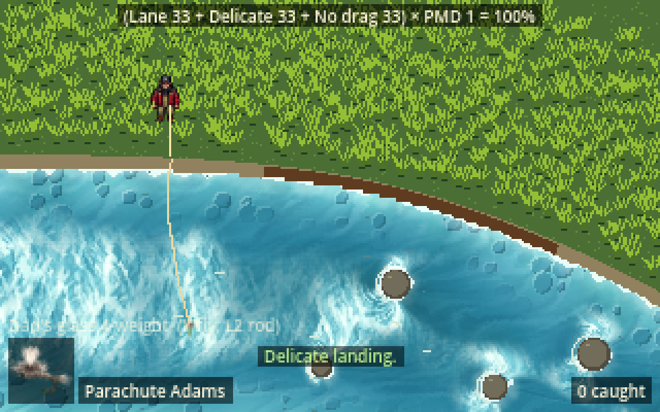
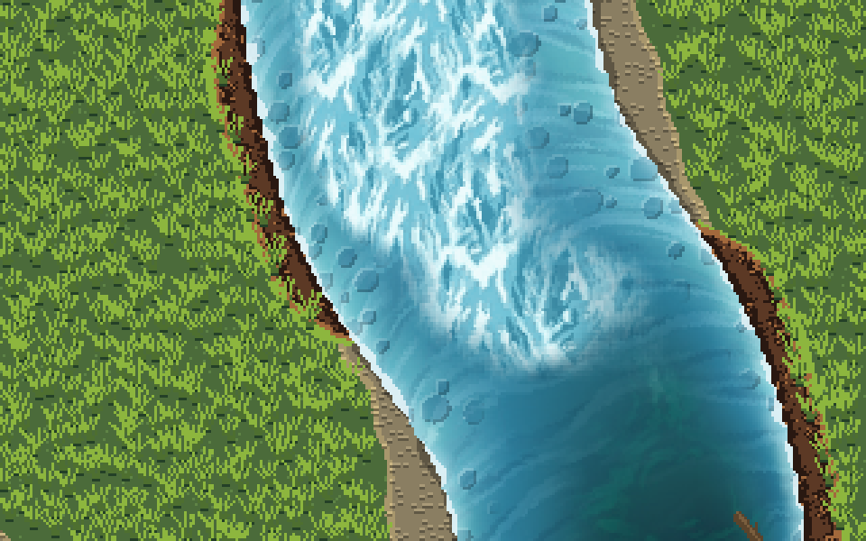
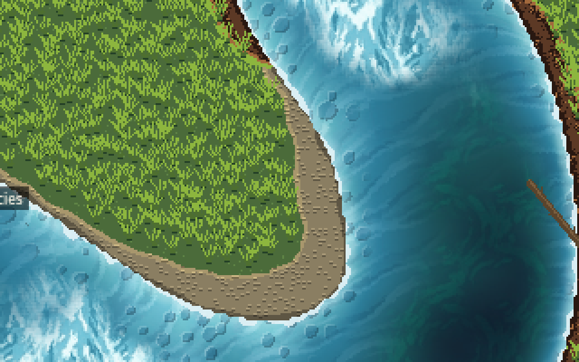

# REQ-0013: A shoreline that matches the water and grass

Status: approved by Traver 2026-11-05 ("looks good" after reviewing the cut bank strip); built

## Problem

The water (REQ-0006, PR #55) and the bank grass (REQ-0012) are now textured, lit and moving, but the strip of land between them is still two flat colours painted pixel by pixel in `stream_scene._make_stretch_texture`: a tan gravel band and a brown cut-bank band on the outside of bends, with hard stair-step edges. It reads as a placeholder next to everything around it.

Built (in-engine, 3x): the cut bank on the outside of a bend, and a point bar with placeholder gravel.

## Player story

As a player, I want the river's edge to look like a real bank, wet stones at the waterline, dry gravel and sand above, an earth cut bank under the grass on the outside of a bend, so that the edge of the water reads at a glance and the whole scene feels like one place.

## Feel goals

- **One picture.** The bank uses the same palette and pixel density as the water and grass, with no hard stair-step edges between them.
- **Readable zones.** From the water out: a thin wet line that is darker than the dry stones, then dry gravel and sand, then a soft, ragged edge where grass takes over. Point bars on the inside of a bend are wide and pebbly; the outside of a bend is a dark earth face with an overhanging grass lip.
- **Calm.** The bank doesn't move. It must not compete with the water or the rise rings for attention.
- **Cheap.** One draw for the bank, baked once per stretch, 60 fps on the Deck, works in the web build.

## Scope

- **`BankView`**: a new view (layer: views, beside `WaterView` and `GrassView`) that draws all of a stretch's land: the wet line, gravel, point bars, sand, the cut bank, the gravel bars, and the plain ground the grass grows on. One quad with a shader, like `WaterView`, drawn behind the stream scene and after the water, so logs and the angler stay on top. It reads the field's existing `shore` and `bend` layers and the `GravelBar` features through `setup`, baked to a texture once, so nothing is simulated live.
- **`BankZones`** (model): the rules for where each ground goes (face height from `bend`, gravel reach with point bars and gravel bars, and the order face, wet, gravel, sand, ground). The view bakes its widths per field cell and the shader does the same comparison per pixel with a ragged-edge wobble.
- **Texture slots, not code-painted art.** The shader tiles small seamless textures picked per pixel by zone: **wet stones**, **dry gravel**, **sand**, and the **cut bank** strip, with ragged noise edges between them. Traver made the cut bank in PixelLab (64×64, shrunk to a 64×16 strip, `assets/bank/cut_bank.png`). The other three slots are empty for now and draw placeholder pebbles in a tint, and the PR says so clearly.
- **The face strip** repeats along the bank: across it by distance from the water (mud at the waterline, the grass lip at the top), along it by x on a bank that runs across the screen and y on one that runs up it. Where the face tapers off at the ends of a bend, the grass lip stays whole and the middle rows drop out.
- **`BankLook`** resource in `data/bank_looks/spring.tres`: the four textures, tints (also the placeholder colours), the ground and tuft colours, zone widths in metres (wet line, gravel, point bar, sand fringe), where the face starts and reaches full height on `bend`, its height and lip, and edge raggedness. Traver tunes it in the Inspector, like the water and grass looks; the Bank node previews the demo stretch in the editor.
- **One look.** The soft and crisp pair was for blended texture joins; with hard ragged edges between grounds there's nothing to compare, so there's one look (answer to question 3, Claude's call; easy to add a second file later).
- **The stream scene stops painting the land.** `_make_stretch_texture` paints only the old flat water, and nothing at all when the clear water is on. `stream_scene.gd` goes from 449 to 430 lines and its R9 cap from 451 to 430.

## Out of scope

Rocks, logs, reeds and cattails on the bank as separate sprites; seasonal looks (spring only); footprints; wet sand that changes with rain or water level; the old non-stretch test screen; walking speed or fish behaviour on gravel.

## Systems touched

| System | Changes? | Depends on the change? | How it's checked |
|---|---|---|---|
| Casting | No | No | `playthrough_test` unchanged |
| River | Yes: new `BankView`, `BankZones` and `BankLook`; the stream scene stops painting the land | Water view (unchanged, draws underneath), grass view (grows where gravel isn't; unchanged) | new `bank_test`: zones land where the field says (wet next to water, cut bank only on outside bends, no bank pixels over water); `data_test` loads every bank look; `water_view_test`, `grass_test` unchanged |
| Fishing | No | No | `playthrough_test` unchanged |
| Weather look | No: the grade already tints everything drawn below it | | `weather_view_test` unchanged |
| UI and modes | No | | |
| Input | No | | |
| Saves | No | | |

## Acceptance criteria

- Every land pixel the stream scene used to paint gravel or cut bank is drawn by `BankView`, and no `BankView` pixel lies on water (automated).
- The wet line sits against the water, and the cut bank only appears where `bend` says outside of a bend (automated).
- The look comes only from `BankLook` data; swapping the `.tres` changes it with no code change (automated: both looks load and render).
- `stream_scene.gd` gets shorter and its R9 cap goes down (automated).
- All suites pass in `tools/run_tests.sh`.
- In-engine screenshots of a riffle, the bend and a point bar, with Traver's textures if they're in, in the PR (playtest).

## Playtest checks

Walk the whole near bank and the bend on keyboard and DualSense. Check the wet line under the clear water's foam, the cut bank under the grass on the bend, and the point bar. Cycle the weather (R2 / F2) to see the bank under rain and storm. Check the browser build (rendering changed). Not checked on the Deck unless Traver does.

## Open questions

1. **Textures:** Traver made the cut bank in PixelLab (2026-11-05). Wet stones, dry gravel and sand are still to come (64×64 seamless, top-down 3/4, spring palette); placeholders until then.
2. **Face:** an earth face with a grass lip and roots (Traver, 2026-11-05). At 8 px per metre a 1 m face is 8 to 16 px tall, so the 64×64 tile was shrunk to 64×16; the roots come out as flecks at that size.
3. **Looks:** one (see Scope).
4. The face strip runs along x or y, whichever the bank is closer to, so a bank at about 45° shows a seam where it switches. Fine for the demo; a true along-the-bank coordinate can come with the river sections work (REQ-0014).
